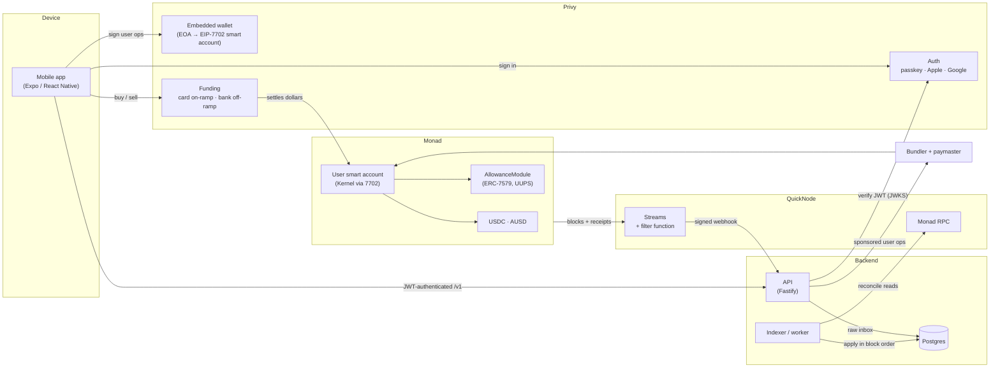

# waterlemon

Technical overview of waterlemon: a dollar account on Monad built on Privy
embedded wallets, EIP-7702 smart accounts, sponsored user operations, an
on-chain allowance module for AI agents, and a QuickNode Streams indexer.

> This repository is the hackathon submission. It contains the smart
> contracts and the architecture documentation. The mobile app and backend
> live in a private repository.

## Sidetracks

| Track                         | What we built with it                                                                                                     | Deep dive                                    |
| ----------------------------- | ------------------------------------------------------------------------------------------------------------------------- | -------------------------------------------- |
| **QuickNode**                 | Streams with a custom filter feed our indexer every transfer and allowance event; QuickNode RPC serves reads and reconciliation | [docs/quicknode.md](docs/quicknode.md)       |
| **Privy**                     | Passkey, Apple and Google sign-in; embedded wallets upgraded to smart accounts with EIP-7702; card on-ramp and bank off-ramp | [docs/privy.md](docs/privy.md)               |
| **Agora (AUSD)**              | AUSD as a first-class dollar: hold, send, receive, cash out, and grant agent allowances in it                             | [docs/agora-ausd.md](docs/agora-ausd.md)     |

## How it fits together



Four pieces, each with one job:

- **The app** owns every byte the user signs. It encodes every call itself and
  checks it right before signing. The server never hands the app calldata.
- **The API** authenticates users with Privy, records what the user *intends*
  (a send, an allowance), and sponsors gas within per-user and global budgets.
  It has no keys that can move user funds.
- **The indexer** is the only writer of on-chain facts. It consumes QuickNode
  Streams in strict block order and writes balances, activity and allowance
  state. Postgres roles enforce this, so it doesn't depend on convention.
- **The contracts** enforce what must never depend on our servers. That
  includes an agent's spending limit.

More detail, including the trust model and deployment, is in
[docs/architecture.md](docs/architecture.md).

## The main flows

### 1. Open an account

1. The user signs up with a **passkey**, **Apple** or **Google** through Privy.
2. Privy creates an **embedded Ethereum wallet** for them.
3. On the first transaction the wallet signs an **EIP-7702 authorization**
   that delegates the EOA to a Kernel v3 smart account. The account address
   stays the same as the wallet address the user already has.
4. The API verifies the Privy JWT against Privy's JWKS and creates the user
   record. The user picks an `@handle` so friends can pay them.

### 2. Add money (on-ramp)

1. The user taps **Add money** and pays by card through **Privy's funding
   flow**. Privy routes the payment to a ramp provider (Stripe or MoonPay).
2. The provider delivers USDC or AUSD on Monad straight to the user's account.
3. QuickNode Streams delivers the incoming `Transfer` to the indexer. The
   balance and the "Money added" feed entry appear only after that.

On testnet, the ramp is simulated end to end by [`MockUsdc`](contracts/src/MockUsdc.sol).
The backend holds its mint authority and mints or burns against a real
on-chain balance. The rest of the pipeline is the same as on mainnet.

### 3. Send dollars

1. The user picks a contact or an `@handle` and an amount.
2. The app builds the ERC-20 transfer as a user operation. Privy signs it, and
   the API's bundler proxy sponsors the gas. **The user never holds MON.**
3. The send shows as *pending* until the indexer sees the transfer on chain.
   Then it becomes *sent* for the sender and *received* for the recipient,
   and the recipient gets a push notification.

### 4. Give an AI agent an allowance

1. The user names an agent, pastes its address, and picks a cap and a period
   (for example 50 AUSD over the next 7 days).
2. In one sponsored operation, the app installs
   [`AllowanceModule`](contracts/src/AllowanceModule.sol) on the account as an
   ERC-7579 executor (first time only) and grants the allowance.
3. The agent calls `spend()` with **its own key and its own gas**. The module
   checks the epoch, revocation, pause, expiry, payee and cap, then moves the
   tokens out of the user's account.
4. The indexer tags the agent's transfers in the feed. The user can pause,
   resume or revoke at any time, and revocation is final.

### 5. Cash out (off-ramp)

1. The user taps **Cash out**, chooses an amount, and sells USDC or AUSD for
   fiat through the ramp provider.
2. The dollars leave the account in a sponsored transfer to the provider. The
   indexer records the withdrawal, and the user gets a "withdrawal ready"
   push when it settles.

## What's in this repo

```
README.md               you are here
docs/
  architecture.md       components, trust model, data flow, deployment
  quicknode.md          Streams, filter function, ordered ingest, RPC
  privy.md              sign-in, embedded wallets, EIP-7702, on/off-ramp
  agora-ausd.md         AUSD as a dollar rail across the product
contracts/
  src/AllowanceModule.sol   agent allowances (ERC-7579 executor, UUPS proxy)
  src/MockUsdc.sol          testnet ramp simulator token
  test/                     unit, adversarial, fuzz, invariant and upgrade tests
  script/                   deploy and upgrade scripts
```

## Deployed contracts (Monad testnet, chain 10143)

| Contract                        | Address                                      |
| ------------------------------- | -------------------------------------------- |
| AllowanceModule (proxy)         | `0x63d270A41307B106f02AD7B1442D42879e9DAa8B` |
| AllowanceModule (implementation)| `0x3EE2469bcD3de6bA6C99688895892106A540e633` |

Accounts install the **proxy** as their executor. An upgrade swaps the
implementation in one admin transaction, and no user has to sign anything
again.

## Build and test the contracts

```bash
git clone --recurse-submodules https://github.com/Cortex-XYZ/waterlemon-hackathon
cd waterlemon-hackathon/contracts
forge build
forge test
```

See [contracts/README.md](contracts/README.md) for the contract design.

## Tech stack

| Layer      | Choice                                                                    |
| ---------- | ------------------------------------------------------------------------- |
| Chain      | Monad (mainnet 143, testnet 10143)                                        |
| App        | Expo, React Native, expo-router, viem, permissionless                     |
| Identity   | Privy (passkeys, Apple, Google, embedded wallets, funding)                |
| Accounts   | EIP-7702 delegation to ZeroDev Kernel v3, EntryPoint v0.7                 |
| Gas        | Bundler and paymaster behind a metered API proxy                          |
| Backend    | Node 24, Fastify, Postgres (Neon), no ORM                                 |
| Indexing   | QuickNode Streams (primary), QuickNode RPC (reads and reconciliation)     |
| Dollars    | USDC and AUSD                                                             |
| Contracts  | Solidity 0.8.28, Foundry, OpenZeppelin upgradeable (UUPS, ERC-7201)       |
| Hosting    | Fly.io (API and worker), EAS / TestFlight (app)                           |
