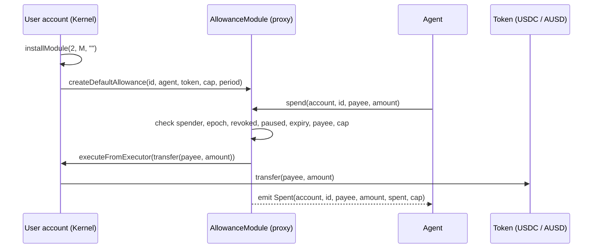

# Contracts

| Contract                                     | Purpose                                                                   |
| -------------------------------------------- | ------------------------------------------------------------------------- |
| [`AllowanceModule`](src/AllowanceModule.sol) | ERC-7579 executor: capped, time-boxed token allowances for AI agents      |
| [`MockUsdc`](src/MockUsdc.sol)               | Testnet only: 6-decimal dollar with a single mint authority, used to simulate the on/off-ramp |

## AllowanceModule

A user's smart account (Kernel v3, through EIP-7702) installs the module as
an ERC-7579 **executor**. The user grants an agent's address an allowance
over one ERC-20. The agent then spends from the user's account with **its own
key and its own gas**, and the user doesn't sign anything at spend time. The
limits are enforced by the module, not by our backend.



### Granting

| Function                                               | Semantics                                                                     |
| ------------------------------------------------------ | ----------------------------------------------------------------------------- |
| `createDefaultAllowance(id, spender, token, cap, period)` | `cap` spendable over a single `period`, then expired; any payee            |
| `createAllowance(id, params)`                          | Repeating window (`cap` per `period`), optional `expiresAt`, optional payee allowlist |

`id` is chosen by the caller (we use `bytes32(bytes16(uuidv7))`). An id can
never be reused on the same account, even after it's revoked.

### Spending

- `spend(account, id, payee, amount)`: the agent submits the transaction
  itself.
- `spendWithSig(...)`: an EIP-712 meta-transaction. The agent signs and
  anyone can relay it, with a per-allowance nonce and a deadline.
- `check(account, id, payee, amount)`: a free view that returns the exact
  reason a spend would fail, so an agent can check before submitting.

Checks run in a fixed order. The first failure is the revert reason:

```
NotTheSpender → StaleEpoch → Revoked → Paused → Expired → PayeeNotAllowed → OverCap → TransferFailed
```

The window rolls forward by whole periods from its anchor, so "resets in 6h"
doesn't drift with usage.

### Controls

| Control                        | How                                                                                     |
| ------------------------------ | --------------------------------------------------------------------------------------- |
| Pause / resume                 | `setPaused(id, bool)`: reversible; keeps `spent` and the window                         |
| Revoke                         | `revoke(id)`: final                                                                     |
| Reinstall invalidates          | `onInstall` / `onUninstall` bump the account's epoch, so earlier grants revert `StaleEpoch` |
| Per-account delegated cap      | The sum of live caps per account is bounded (`maxAccountDelegatedCap`)                  |
| Module-wide freeze             | `freezeModule()`: admin circuit breaker that halts every spend                          |
| Hostile tokens                 | Reentrancy and non-standard return values are covered by adversarial tests              |

### Storage and upgrades

- **Packed storage.** An allowance is three storage slots, and a `spend()`
  writes only one of them.
- **ERC-7201 namespaced storage**
  (`erc7201:waterlemon.storage.AllowanceModule`), so new implementations
  can't collide with old storage.
- **UUPS proxy.** Accounts install the proxy address. The admin upgrades the
  implementation in one transaction, and no account has to reinstall or
  re-sign. `admin` can be a multisig; `onlyAdmin` only checks
  `msg.sender`.

### Events

```solidity
event AllowanceGranted(address indexed account, bytes32 indexed id, address indexed spender,
                       address token, uint96 cap, uint24 period, uint48 expiresAt, bool unrestricted);
event AllowancePausedSet(address indexed account, bytes32 indexed id, bool paused);
event AllowanceRevoked(address indexed account, bytes32 indexed id);
event Spent(address indexed account, bytes32 indexed id, address indexed payee,
            uint256 amount, uint96 spent, uint96 cap);
event ModuleFrozenSet(bool frozen);
```

Our indexer receives these through QuickNode Streams (see
[docs/quicknode.md](../docs/quicknode.md)).

## Deployments

Monad testnet (chain 10143):

| Contract                         | Address                                      |
| -------------------------------- | -------------------------------------------- |
| AllowanceModule (ERC-1967 proxy) | `0x63d270A41307B106f02AD7B1442D42879e9DAa8B` |
| AllowanceModule (implementation) | `0x3EE2469bcD3de6bA6C99688895892106A540e633` |

## Build and test

Requires [Foundry](https://getfoundry.sh).

```bash
git submodule update --init --recursive   # if you didn't clone with --recurse-submodules
forge build
forge test
```

| Suite                                    | Covers                                                   |
| ---------------------------------------- | -------------------------------------------------------- |
| `AllowanceModule.t.sol`                  | Grant, spend, window roll, pause, revoke, views          |
| `AllowanceModuleDefaultAllowance.t.sol`  | The single-period default grant                          |
| `AllowanceModuleAdversarial.t.sol`       | Reentrant and false-returning tokens, stale epochs, expiry and window edges, id reuse |
| `AllowanceModuleFuzz.t.sol`              | Fuzz plus invariants: spent ≤ cap, window stays on its anchor, module never holds tokens |
| `AllowanceModuleMultisigAdmin.t.sol`     | Admin as a multisig                                      |
| `AllowanceModuleUpgrade.t.sol`           | Upgrade authority and storage surviving an upgrade       |
| `MockUsdc.t.sol`                         | Mint/burn authority                                      |

Compiler settings are pinned in `foundry.toml` (solc 0.8.28, `via_ir`, 200
runs, no metadata hash) so the deployed bytecode reproduces exactly.

## Deploy

```bash
# implementation + proxy, CREATE2
forge script script/DeployAllowanceModule.s.sol:DeployAllowanceModule \
  --rpc-url $MONAD_RPC_URL --broadcast --verify

# point the proxy at a new implementation (admin key)
PROXY_ADDRESS=0x63d2...DAa8B \
forge script script/UpgradeAllowanceModule.s.sol:UpgradeAllowanceModule \
  --rpc-url $MONAD_RPC_URL --broadcast --verify
```
