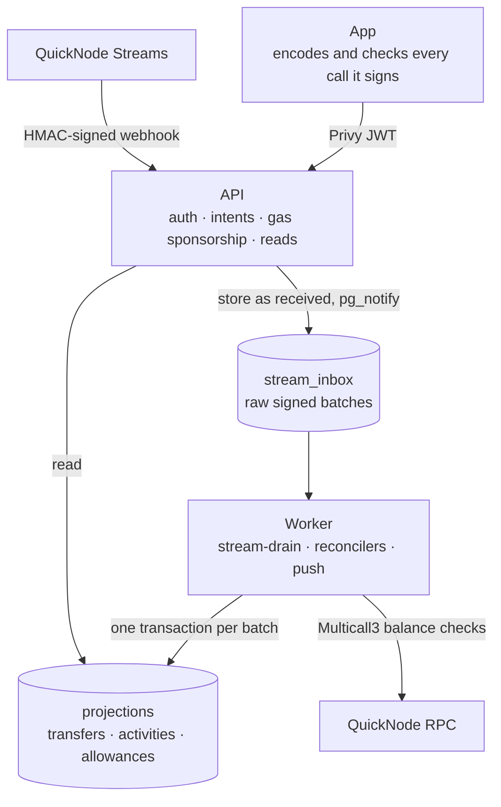
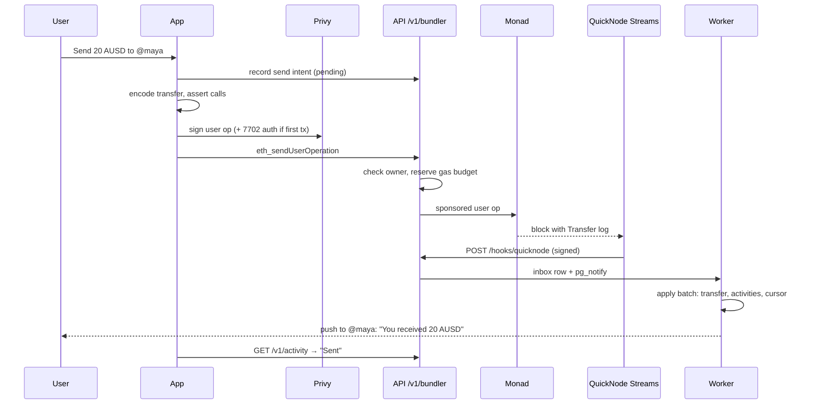

# Architecture

## Principle: the chain is the ledger

waterlemon keeps two kinds of data:

1. **What happened on chain**: balances, transfers, allowance state. Only the
   indexer writes this, and only after it has seen the block.
2. **What the chain can't answer**: handles, push tokens, the name a user gave
   an agent, a send the user just submitted. The API writes these as
   *intents*.

The split is enforced by the database, not by convention. Postgres has three
roles: an owner for migrations, an API role and a watcher role. Column grants
and a trigger keyed on `session_user` stop the API role from writing any
on-chain column. Even a fully compromised API cannot make a balance or a
"received" entry appear.

## Components

### App

- Expo / React Native, iOS first (TestFlight).
- Holds the Privy session and the embedded wallet.
- Builds every transaction itself, from what the user typed, against contract
  addresses compiled into the app. The server can return an allowance id, but
  never calldata. A compromised API can lie about state, but it cannot get a
  transfer, a foreign executor or a different agent signed.

### API

- Fastify on Node 24. TypeScript runs directly, with no build step.
- `GET/POST /v1/*` behind Privy JWT verification (ES256 against Privy's JWKS).
- `POST /v1/bundler` is a narrow proxy to the bundler and paymaster:
  - it accepts only an allowlist of JSON-RPC methods;
  - it refuses user operations for any account but the caller's;
  - it reserves each operation's worst-case gas against a per-user daily
    ceiling and a global daily budget before sponsoring it.
- `POST /hooks/quicknode` receives Streams deliveries (see
  [quicknode.md](quicknode.md)).

### Worker

One process running named jobs in a loop. A Postgres advisory lock means only
one instance is active and a standby takes over on failure.

| Job               | Does                                                                     |
| ----------------- | ------------------------------------------------------------------------ |
| `stream-drain`    | Applies Streams batches in block order                                   |
| `stream-watchdog` | Reactivates a paused Stream through the QuickNode API                    |
| reconcilers       | Compare indexed balances against live Multicall3 reads over RPC          |
| push              | "Payment received", "withdrawal ready", agent spend notifications        |
| `inbox-prune`     | Removes applied inbox rows past retention                                |

The API and worker share a `shared/` module and never import each other. A
lint rule enforces this, so either one can crash or redeploy without taking
the other down.

### Contracts

- **AllowanceModule**: agent allowances, enforced on chain. See
  [contracts/README.md](../contracts/README.md).
- **Kernel v3**: the smart-account code each user's EOA delegates to through
  EIP-7702.
- **USDC / AUSD**: the dollars. Both are standard ERC-20s on Monad and use
  the same indexing, send and allowance paths.

## Lifecycle of a send

## Deployment

| Piece      | Where                                                                    |
| ---------- | ------------------------------------------------------------------------ |
| API        | Fly.io, two machines                                                     |
| Worker     | Fly.io, one active and one standby behind the advisory lock              |
| Database   | Neon Postgres, compute pinned so it never suspends                       |
| Releases   | GitHub Actions: build image → run migrations → check `/health` and `/health/watcher` |
| App        | EAS Build → TestFlight; over-the-air updates when native code is unchanged |
