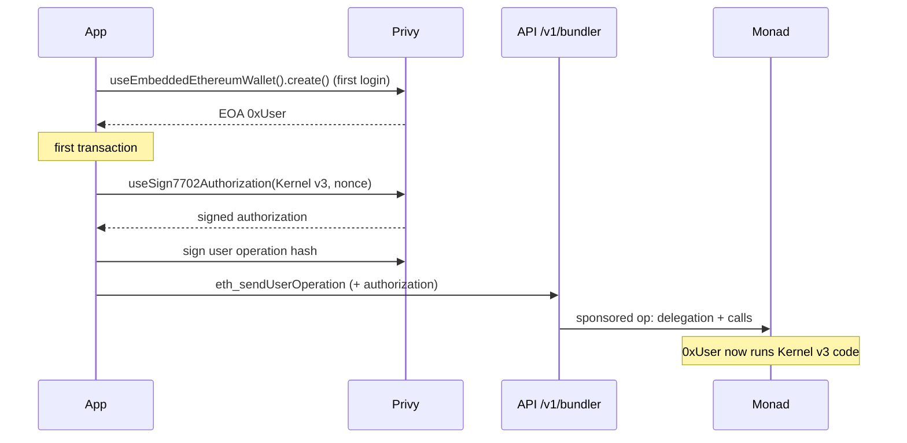

# Privy

Privy handles identity, key custody and fiat funding. We use four parts of it:
**auth**, **embedded wallets**, **EIP-7702 authorization signing** and
**funding** (on-ramp and off-ramp).

## 1. Sign-in

| Method  | SDK                                  | Notes                                                       |
| ------- | ------------------------------------ | ----------------------------------------------------------- |
| Passkey | `@privy-io/expo/passkey`             | Sign up and log in; relying party bound to our associated domain |
| Apple   | Privy OAuth                          | iOS                                                         |
| Google  | Privy OAuth                          | All platforms                                               |

A user who signed up with Apple or Google can add a passkey later from
settings. All methods resolve to the same Privy user (DID).

Passkeys need the app's associated domain and `.well-known` files to match
Privy's relying-party configuration. The app reads the relying party from
config, so each environment binds to its own domain.

## 2. Backend verification

Every `/v1` request carries the Privy access token. The API verifies it
without calling Privy per request:

```ts
const jwks = createRemoteJWKSet(
  new URL(`https://auth.privy.io/api/v1/apps/${PRIVY_APP_ID}/jwks.json`),
);

const { payload } = await jwtVerify(token, jwks, {
  algorithms: ['ES256'],
  issuer: 'privy.io',
  audience: PRIVY_APP_ID,
});

// payload.sub is the Privy DID → find-or-create the user row
```

- A bad or expired token returns `401`.
- If Privy's key server can't be reached, the API returns `503`, never a
  silent `401` that would log users out.

## 3. Embedded wallet → smart account (EIP-7702)



- Each user gets one **Privy embedded EOA**, created on first login, with
  Monad set through `supportedChains`.
- Instead of deploying a separate counterfactual smart account (ERC-4337
  style), the EOA **delegates to ZeroDev Kernel v3 through EIP-7702**.
  `useSign7702Authorization` signs the delegation at the EOA's current nonce.
- So the account address *is* the wallet address. Funds sent before the
  first transaction are already in the right place, and there is no address
  migration.
- Kernel gives the account ERC-4337 user operations (EntryPoint v0.7) and
  ERC-7579 modules, which is what lets us install
  [`AllowanceModule`](../contracts/src/AllowanceModule.sol) as an executor.

### Gas sponsorship

Users never hold MON. Every user operation goes through `POST /v1/bundler`,
which forwards to the bundler and paymaster after three checks:

1. **Method allowlist.** Only `eth_sendUserOperation`,
   `eth_estimateUserOperationGas`, `pm_getPaymasterData` and the like.
2. **Ownership.** The operation's `sender` must be the authenticated user's
   own wallet.
3. **Budget.** The worst-case gas is reserved in a `sponsorships` table
   against a per-user daily ceiling and a global daily budget before the
   paymaster signs.

### What the app checks before every signature

Privy signs a user-operation hash, which a user can't read. So the app never
signs calldata it didn't build. Before each signature, `assertAllowanceCalls`
(and its counterpart for sends) decodes the batch and checks:

- every target is a contract address compiled into the app;
- every selector is one we expect;
- the arguments match what the user typed on screen.

## 4. Funding: on-ramp and off-ramp

### On-ramp: card → dollars on Monad

```ts
const funding: FundingConfig = {
  address: wallet.address,
  chain: monad,                 // 143 (10143 on testnet)
  asset: 'USDC',                // or AUSD
  amount: '10',                 // user-entered, default $10
  defaultPaymentMethod: 'card',
  // no preferredProvider: Privy picks whichever provider serves the user's region
};

await fundWallet(funding);
```

- Card and Apple Pay purchases go through **Privy's funding flow**, with
  Stripe and MoonPay enabled in the Privy dashboard. Privy picks the
  provider by region and payment method.
- Dollars land directly on the user's 7702 account on Monad. The app then
  waits on the indexer, not on the ramp's callback: the balance and the
  "Money added" entry appear when QuickNode Streams delivers the `Transfer`.

### Off-ramp: dollars → bank

- The user chooses an amount and a linked payout method. The app builds a
  sponsored transfer of USDC or AUSD to the provider's deposit address.
- The indexer records the outgoing transfer as a withdrawal. When the
  provider confirms the payout, the worker sends a "withdrawal ready" push.

### Testnet: a simulated ramp with real tokens

Fiat providers don't settle on testnet, so the same buy and sell flows run
against [`MockUsdc`](../contracts/src/MockUsdc.sol):

| Route                     | On chain                         |
| ------------------------- | -------------------------------- |
| `POST /v1/ramp/buy`       | `MockUsdc.mint(user, amount)`    |
| `POST /v1/ramp/sell`      | `MockUsdc.burnFrom(user, amount)`|

- The backend holds the token's single mint authority.
- Responses are labeled `simulated: true`, and the route refuses to start
  unless the chain is testnet (10143), the configured key is the token's
  minter, and the token has 6 decimals.
- Everything downstream (Streams, indexer, feed, push) is the production
  path, so the demo exercises the real pipeline.
