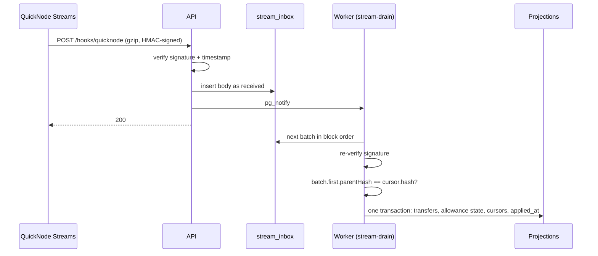

# QuickNode

QuickNode is how chain data gets into waterlemon. **Streams** is the only
writer of on-chain facts into our database, and **RPC** handles every read
that needs the live chain.

## Requirements

The indexer needs:

- every block delivered, with reorgs reported instead of hidden;
- only the logs we index, filtered before delivery;
- enough batch metadata to prove no block was skipped.

Streams covers all three: delivery guarantees, a server-side filter function,
and batch ranges plus parent hashes we check against our own cursor.

## Stream configuration

| Setting            | Value                                         |
| ------------------ | --------------------------------------------- |
| Network            | Monad (testnet 10143; mainnet 143)            |
| Dataset            | Block with Receipts                           |
| Latest block delay | 10 blocks                                     |
| Batch size         | 5 blocks                                      |
| Reorg handling     | Resend on reorg                               |
| Destination        | Webhook → `POST /hooks/quicknode`, gzip       |
| Filter             | Generated from config (below)                 |

## The filter function

The filter runs on QuickNode's side, so a block with nothing relevant to us
costs nothing to deliver. It keeps three kinds of log:

1. **Dollar transfers**: ERC-20 `Transfer` events from USDC and AUSD.
2. **Allowance events**: anything emitted by the AllowanceModule proxy
   (`AllowanceGranted`, `Spent`, `AllowancePausedSet`, `AllowanceRevoked`, …).
3. **Module installs**: ERC-7579 `ModuleInstalled` / `ModuleUninstalled`
   events that name our module, so we know when an account's allowances go
   stale.

It also keeps **failed transactions sent to the module, with their calldata**.
That lets us show a user *why* an agent's spend was refused (over cap,
paused, expired) instead of silently dropping it.

The output is trimmed to what the indexer needs: block number, hash and
timestamp, receipts with gas used and effective gas price, plus the batch's
range, its first block's `parentHash`, and any reorged blocks.

```js
function main(stream) {
  const MODULE = ALLOWANCE_MODULE_PROXY;
  const TOKENS = [USDC, AUSD];
  const TRANSFER = keccak('Transfer(address,address,uint256)');
  const INSTALL = [keccak('ModuleInstalled(uint256,address)'),
                   keccak('ModuleUninstalled(uint256,address)')];

  const wanted = (log) =>
    log.address === MODULE ||
    (log.topics[0] === TRANSFER && TOKENS.includes(log.address)) ||
    (INSTALL.includes(log.topics[0]) && log.data.includes(MODULE));

  // For each block: keep receipts with a wanted log, or sent to the module.
  // Attach calldata for failed module calls. Drop empty blocks.
  // Return { range, first: {number, parentHash}, last, blocks, reorged }.
}
```

We generate the filter from the same config the indexer runs with. If the
live Stream's filter ever differs from what the worker expects, the worker
halts with `filter-mismatch` rather than indexing a partial view.

## Ingest: accept fast, apply carefully



**The API does as little as possible.** It verifies the signature, stores the
body exactly as received, notifies the worker and returns `200`. QuickNode
never waits on our database logic, and a worker restart loses nothing.

**The worker is strict.**

- **Ordering.** Each tracked contract has a cursor (block number and hash). A
  batch applies only if it starts at `cursor + 1` and its first block's
  `parentHash` equals the cursor's hash. That one check catches both gaps and
  reorgs.
- **Atomicity.** A batch's transfers, activities, allowance state, cursor
  moves and `applied_at` commit in one transaction, or none of it does.
- **Idempotency.** Retried deliveries are extra inbox rows, skipped once the
  cursor has passed them. Transfers are unique on
  `(chain_id, tx_hash, log_index, direction)` and activities on
  `(user_id, idempotency_key)`, so replaying a batch is harmless.
- **Named halts.** If anything is off, the drain stops with a reason (`gap`,
  `parent-mismatch`, `filter-mismatch`) instead of guessing. `/health/watcher`
  reports it.

## Operating it

- **Watchdog.** If QuickNode pauses the Stream (for example after repeated
  delivery failures during a deploy), the `stream-watchdog` job reactivates it
  through the Streams API within about two minutes. The cursor check
  guarantees the resumed Stream picks up with no gap.
- **Backfill.** A gap is fixed by creating a one-off Stream over the missing
  range. The webhook accepts several signing tokens at once, so the backfill
  runs alongside the live Stream, and the cursor puts both in order.
- **Health.** `/health/watcher` reports how long ago the last delivery arrived
  and how far each cursor is behind the chain head. The deploy pipeline fails
  if it isn't healthy.

## QuickNode RPC

The same QuickNode Monad endpoint serves every live read, rate-limited on our
side:

- **Reconcilers** compare indexed balances against a Multicall3 read of
  `balanceOf` for every account. They alert on drift and never overwrite.
- **Allowance reads** like `allowanceOf` and `epochOf` at the event's block,
  so the indexed state matches the chain at that point.
- **Fallback ingest.** The worker can also run on `eth_getLogs` polling up to
  the `finalized` block, or subscribe to Monad's `monadNewHeads` / `monadLogs`
  over WebSocket. That's useful in development and as a safety net, with
  Streams as the source in production.
